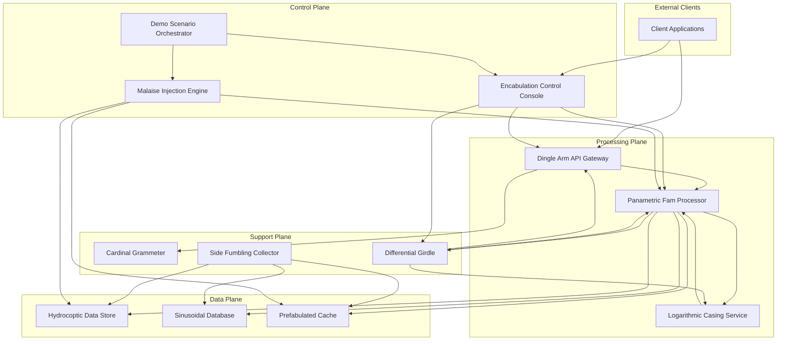
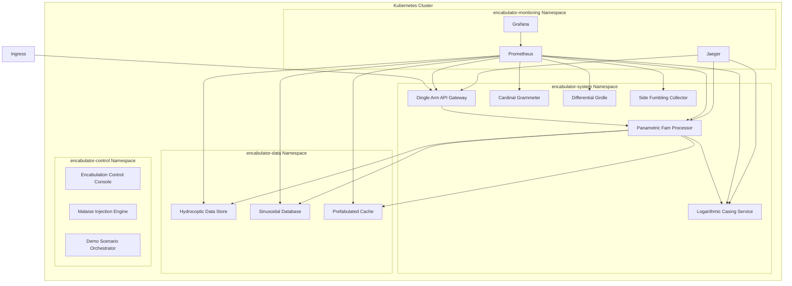
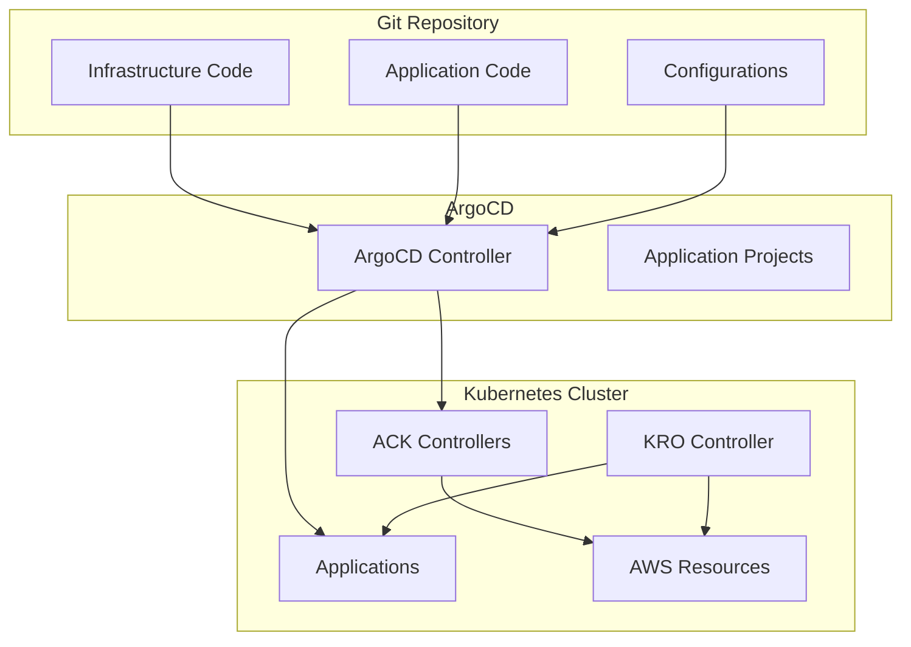

# Design Document: Cloud Native Encabulator Microservices Demo

## Overview

The Cloud Native Encabulator Microservices Demo is an educational project that demonstrates Kubernetes microservices architecture using the humorous Cloud Native Encabulator narrative as a framework. This design document outlines the architecture, components, interfaces, data models, error handling, and testing strategy for implementing the requirements.

The system is designed as a comprehensive microservices architecture that showcases best practices in Kubernetes deployment, observability, configuration management, resilience patterns, and scalability. The architecture is divided into four main planes: Data Plane, Processing Plane, Support Plane, and Control Plane, each containing specialized services that fulfill specific roles within the system.

## Architecture

### System Architecture Overview

The Cloud Native Encabulator Microservices Demo follows a modern microservices architecture deployed on Kubernetes. The system is organized into four distinct planes:

1. **Data Plane**: Responsible for data storage, persistence, and caching
2. **Processing Plane**: Handles core business logic, message routing, and API gateway functionality
3. **Support Plane**: Provides cross-cutting concerns like authentication, configuration, and resource management
4. **Control Plane**: Provides interactive system control, demonstration capabilities, and chaos engineering



### Deployment Architecture

The system is deployed on Kubernetes with the following characteristics:

1. **Namespace Organization**:

   - `encabulator-system`: Core system components (Processing and Support planes)
   - `encabulator-data`: Data plane components
   - `encabulator-monitoring`: Monitoring and observability tools
   - `encabulator-control`: Control plane components (web interface, chaos engineering, demo orchestration)

2. **Resource Management**:

   - Appropriate resource requests and limits for all components
   - Horizontal Pod Autoscaler configurations for scalable services
   - Pod Disruption Budgets for critical services

3. **Network Policies**:
   - Strict service-to-service communication rules
   - Ingress/egress controls for all components



## Infrastructure Management

### Cloud-Native Infrastructure Approach

The Cloud Native Encabulator Microservices Demo adopts a fully Kubernetes-native approach to infrastructure management, eliminating the need for external infrastructure tools like Terraform or Helm. This approach provides better integration with GitOps practices and maintains consistency with Kubernetes-native workflows.

#### AWS Controllers for Kubernetes (ACK)

**Purpose**: Manage AWS resources directly from Kubernetes using Custom Resource Definitions.

**Implementation**:

- ACK controllers for RDS (PostgreSQL instances)
- ACK controllers for ElastiCache (Redis clusters)
- ACK controllers for IAM roles and policies
- ACK controllers for VPC and networking resources

**Benefits**:

- Infrastructure as Code through Kubernetes manifests
- GitOps-compatible resource management
- Consistent RBAC and security model
- Native Kubernetes lifecycle management

```yaml
# Example: RDS instance managed through ACK
apiVersion: rds.services.k8s.aws/v1alpha1
kind: DBInstance
metadata:
  name: encabulator-postgres
  namespace: encabulator-data
spec:
  dbInstanceIdentifier: encabulator-postgres
  dbInstanceClass: db.t3.micro
  engine: postgres
  masterUsername: encabulator_user
  allocatedStorage: 20
```

#### Kube Resource Orchestrator (KRO)

**Purpose**: Create custom Kubernetes APIs for complex, multi-resource deployments.

**Implementation**:

- Define ResourceGroups that create custom APIs (e.g., EncabulatorDatabase, EncabulatorCluster)
- Orchestrate multiple ACK resources as single composite units
- Handle resource dependencies and creation ordering automatically
- Generate CRDs and controllers dynamically from ResourceGroup definitions

**Benefits**:

- Simplified deployment of complex infrastructure stacks
- Encapsulation of operational knowledge into reusable APIs
- Automatic dependency management between resources
- Platform team can create standardized building blocks for developers

#### ArgoCD GitOps Integration

**Purpose**: Continuous delivery and infrastructure synchronization.

**Implementation**:

- Git-based source of truth for all configurations
- Automated synchronization of infrastructure changes
- Multi-environment promotion workflows
- Rollback and drift detection capabilities

**Benefits**:

- Declarative infrastructure management
- Audit trail for all changes
- Automated deployment pipelines
- Environment consistency



## Components and Interfaces

### Control Plane Components

#### 1. Encabulation Control Console

**Purpose**: Interactive web interface for system control and demonstration.

**Implementation**:

- Modern web application (React/Vue.js with TypeScript)
- Real-time WebSocket connections for live updates
- Integration with Kubernetes API for system control
- GitOps workflow integration for configuration changes

**Interfaces**:

- Web UI for interactive system control
- REST API for programmatic access
- WebSocket API for real-time updates
- Kubernetes API integration for cluster operations

**Technology Stack**:

- Frontend: React with TypeScript, D3.js for visualizations
- Backend: Node.js with Express, Socket.io for real-time
- Kubernetes integration via official client libraries

#### 2. Malaise Injection Engine

**Purpose**: Chaos engineering and failure injection for resilience testing.

**Implementation**:

- Kubernetes operator for failure injection
- Configurable failure scenarios and patterns
- Integration with observability stack for impact measurement
- Safety mechanisms and automatic recovery

**Interfaces**:

- REST API for failure scenario management
- Kubernetes Custom Resources for failure definitions
- Integration with Control Console for visual control

**Technology Stack**:

- Go-based Kubernetes operator
- Custom Resource Definitions for failure scenarios
- Integration with Prometheus for impact metrics

#### 3. Demo Scenario Orchestrator

**Purpose**: Pre-built demonstration scenarios for educational purposes.

**Implementation**:

- Scenario definition and execution engine
- Traffic generation and load simulation
- Automated demonstration workflows
- Integration with monitoring for visual feedback

**Interfaces**:

- REST API for scenario management
- Integration with Control Console for scenario execution
- Traffic generation APIs for load simulation

**Technology Stack**:

- Go-based orchestration service
- Integration with load testing tools (k6, Artillery)
- Scenario definitions as Kubernetes ConfigMaps

### Data Plane Components

#### 1. Hydrocoptic Data Store

**Purpose**: Primary persistence layer for the system.

**Implementation**:

- StatefulSet deployment of PostgreSQL
- Custom wrapper service for domain-specific operations
- Persistent Volume Claims for data durability

**Interfaces**:

- REST API for CRUD operations
- SQL interface for direct queries (internal only)
- Health/metrics endpoint for monitoring

**Technology Stack**:

- PostgreSQL 14.x
- Custom wrapper service in Go
- Kubernetes StatefulSet with PVCs

#### 2. Sinusoidal Database

**Purpose**: Time-series metrics storage for system telemetry.

**Implementation**:

- Lightweight time-series database
- Optimized for high write throughput
- Temporal query capabilities

**Interfaces**:

- Prometheus-compatible API
- REST API for direct queries
- Health/metrics endpoint

**Technology Stack**:

- Prometheus TSDB or VictoriaMetrics
- Go-based query service
- Kubernetes Deployment with ConfigMaps

#### 3. Prefabulated Cache

**Purpose**: In-memory data caching for performance optimization.

**Implementation**:

- Distributed caching service
- TTL management and eviction policies
- Data compression for efficiency

**Interfaces**:

- Redis-compatible API
- REST API for management operations
- Health/metrics endpoint

**Technology Stack**:

- Redis 6.x or KeyDB
- Kubernetes Deployment with anti-affinity rules
- ConfigMaps for cache configuration

### Processing Plane Components

#### 1. Panametric Fam Processor

**Purpose**: Core business logic execution engine.

**Implementation**:

- Horizontally scalable stateless service
- Work distribution and parallel processing
- Event-driven architecture

**Interfaces**:

- REST API for synchronous operations
- Message-based interface for asynchronous operations
- Health/metrics endpoint

**Technology Stack**:

- Node.js 18.x with Express
- Kubernetes Deployment with HPA
- ConfigMaps for business rules

#### 2. Logarithmic Casing Service

**Purpose**: Message broker and event bus for the system.

**Implementation**:

- Topic management and message routing
- Backpressure handling and retry logic
- Message persistence for reliability

**Interfaces**:

- Kafka-compatible producer/consumer API
- REST API for management operations
- Health/metrics endpoint

**Technology Stack**:

- NATS Streaming or RabbitMQ
- Go-based management service
- Kubernetes StatefulSet for message persistence

#### 3. Dingle Arm API Gateway

**Purpose**: External API facade and entry point.

**Implementation**:

- Request routing and load balancing
- Rate limiting and throttling
- Authentication integration

**Interfaces**:

- REST API for client applications
- gRPC interface for internal services
- Health/metrics endpoint

**Technology Stack**:

- Envoy or NGINX
- Custom extensions in Lua or Go
- Kubernetes Deployment with HPA

### Support Plane Components

#### 1. Cardinal Grammeter

**Purpose**: Authentication and authorization service.

**Implementation**:

- Token validation and issuance
- RBAC integration with Kubernetes
- User management

**Interfaces**:

- OAuth2-compatible API
- User management REST API
- Health/metrics endpoint

**Technology Stack**:

- Python with FastAPI
- JWT for token management
- Kubernetes Deployment with ConfigMaps

#### 2. Differential Girdle

**Purpose**: Configuration management service.

**Implementation**:

- Dynamic config updates
- Environment management
- Feature flag control

**Interfaces**:

- REST API for configuration management
- Webhook for configuration change notifications
- Health/metrics endpoint

**Technology Stack**:

- Go-based configuration service
- Kubernetes ConfigMap/Secret controller
- Kubernetes Deployment

#### 3. Side Fumbling Collector

**Purpose**: Resource optimization and cleanup service.

**Implementation**:

- Garbage collection for system resources
- Resource reclamation and optimization
- Automated cleanup processes

**Interfaces**:

- REST API for manual operations
- Scheduled job interface
- Health/metrics endpoint

**Technology Stack**:

- Custom Kubernetes operator in Go
- CronJob for scheduled operations
- Kubernetes Deployment

## Data Models

### Core Data Models

#### 1. Encabulation Request

```json
{
  "requestId": "string (UUID)",
  "timestamp": "string (ISO 8601)",
  "parameters": {
    "grammeters": "number",
    "prefabulation": "boolean",
    "sinusoidalMode": "string (enum: STANDARD, INVERSE, LOGARITHMIC)"
  },
  "priority": "string (enum: LOW, MEDIUM, HIGH)",
  "metadata": {
    "source": "string",
    "correlationId": "string (UUID)",
    "tags": ["string"]
  }
}
```

#### 2. Encabulation Result

```json
{
  "resultId": "string (UUID)",
  "requestId": "string (UUID)",
  "timestamp": "string (ISO 8601)",
  "status": "string (enum: SUCCESS, PARTIAL, FAILED)",
  "data": {
    "encabulationFactor": "number",
    "dingleArmPosition": "number",
    "prefabulationRate": "number"
  },
  "metrics": {
    "processingTime": "number (ms)",
    "resourceUsage": "number",
    "efficiency": "number (percentage)"
  },
  "errors": [
    {
      "code": "string",
      "message": "string",
      "component": "string"
    }
  ]
}
```

#### 3. System Configuration

```json
{
  "configId": "string",
  "version": "number",
  "timestamp": "string (ISO 8601)",
  "environment": "string (enum: DEV, STAGING, PROD)",
  "components": {
    "componentName": {
      "enabled": "boolean",
      "parameters": {
        "key": "value"
      },
      "limits": {
        "requests": "number",
        "concurrency": "number"
      }
    }
  },
  "featureFlags": {
    "featureName": "boolean"
  }
}
```

#### 4. Telemetry Event

```json
{
  "eventId": "string (UUID)",
  "timestamp": "string (ISO 8601)",
  "source": "string (component name)",
  "type": "string (enum: METRIC, LOG, TRACE, ALERT)",
  "severity": "string (enum: DEBUG, INFO, WARNING, ERROR, CRITICAL)",
  "data": {
    "key": "value"
  },
  "correlationId": "string (UUID)",
  "tags": ["string"]
}
```

## Error Handling

### Error Handling Strategy

The system implements a comprehensive error handling strategy with the following characteristics:

1. **Standardized Error Format**:

   - All errors follow a consistent JSON structure
   - Error codes are standardized across services
   - Human-readable messages for troubleshooting

2. **Error Propagation**:

   - Errors are propagated with context enrichment
   - Sensitive information is filtered from error messages
   - Correlation IDs are maintained across service boundaries

3. **Retry Mechanisms**:

   - Exponential backoff for transient failures
   - Circuit breakers for persistent failures
   - Dead letter queues for unprocessable messages

4. **Graceful Degradation**:
   - Fallback mechanisms for critical functionality
   - Partial responses when complete data is unavailable
   - Clear indication of degraded functionality to clients

### Error Categories

| Category          | HTTP Status Codes  | Description                                             | Handling Strategy                            |
| ----------------- | ------------------ | ------------------------------------------------------- | -------------------------------------------- |
| Client Errors     | 400, 401, 403, 404 | Invalid requests, authentication/authorization failures | Return clear error messages, no retry        |
| Service Errors    | 500, 502, 503, 504 | Internal service failures, unavailable dependencies     | Retry with backoff, circuit breaking         |
| Data Errors       | 409, 422           | Data conflicts, validation failures                     | Transaction management, compensation actions |
| Throttling Errors | 429                | Rate limiting, resource exhaustion                      | Backoff and retry, load shedding             |

## Testing Strategy

### Testing Levels

1. **Unit Testing**:

   - Component-level tests for individual services
   - Mocked dependencies for isolation
   - Coverage targets: >80% for critical components

2. **Integration Testing**:

   - Service-to-service communication tests
   - Database interaction tests
   - Message broker integration tests

3. **System Testing**:

   - End-to-end workflow tests
   - Performance and load tests
   - Resilience tests (chaos engineering)

4. **Acceptance Testing**:
   - User scenario-based tests
   - Demo scenario validation
   - Documentation verification

### Testing Tools and Frameworks

| Testing Type        | Tools/Frameworks                           | Implementation               |
| ------------------- | ------------------------------------------ | ---------------------------- |
| Unit Testing        | Go: testify, Python: pytest, Node.js: Jest | Automated in CI pipeline     |
| Integration Testing | Testcontainers, Postman/Newman             | Automated in CI pipeline     |
| System Testing      | K6, Locust, Chaos Toolkit                  | Scheduled runs and on-demand |
| Acceptance Testing  | Cucumber, Robot Framework                  | Pre-release validation       |

### Continuous Testing

The system implements continuous testing with the following characteristics:

1. **CI/CD Integration**:

   - Tests run on every pull request
   - Deployment gates based on test results
   - Automated regression testing

2. **Test Environments**:

   - Ephemeral test environments for PR validation
   - Persistent environments for staging and production
   - Local development testing support

3. **Test Data Management**:
   - Synthetic data generation for testing
   - Data anonymization for production-like testing
   - Test data versioning and management


## Open Source Compliance

### License Management

The project will implement the following license management practices:

1. **License Selection**:

   - Apache 2.0 license for the project
   - Compatible licenses for dependencies

2. **License Documentation**:

   - LICENSE file in the repository root
   - NOTICE file for third-party attributions
   - License headers in source files

3. **Contribution Process**:
   - Developer Certificate of Origin (DCO) for contributions
   - Automated license compliance checking in CI
   - Contribution guidelines documentation
