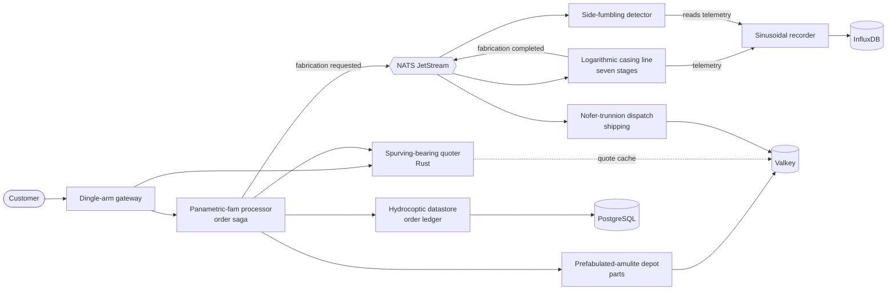
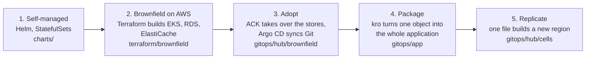
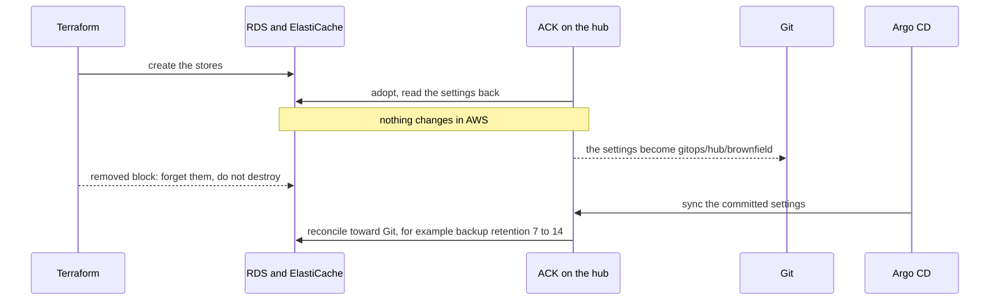
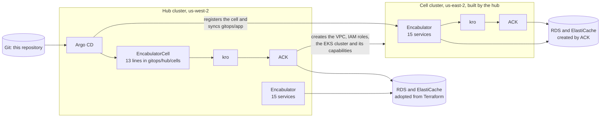

<div align="center">

# Cloud Native Encabulator

**A distributed system that is entirely real and completely ridiculous.**

[](LICENSE)
[](docs/design.md)
[](#polyglot-on-purpose)

</div>

---

For a number of years now, work has been proceeding in order to bring perfection to the crudely
conceived idea of a microservices platform that would not only supply inverse reactive
observability for use in unilateral phase detractors, but would also be capable of automatically
synchronizing cardinal grammeters.

Such an instrument is the **Cloud Native Encabulator**.

The original machine had a base-plate of prefabulated amulite, surmounted by a malleable
logarithmic casing in such a way that the two main spurving bearings were in a direct line with the
panametric fam. This one has fifteen microservices, four backing stores, distributed tracing, and a
web console from which you can break any of it on purpose.

## What this actually is

A **realistic** distributed system you can run, drive, break, and observe. Not a toy with three
services and a `sleep(100)`. Not production either. The gap between those two is where most
learning happens, and almost nothing lives there.

The Encabulator Works is a factory that builds turbo encabulators to order:

1. A customer places an order through the **dingle arm gateway**.
2. The **spurving bearing quoter** prices it (in Rust, burning real CPU on a "pentametric harmonic").
3. The **prefabulated amulite depot** atomically reserves parts, or rejects the order for want of
   hydrocoptic marzlevanes.
4. The **panametric fam processor** runs the order saga and writes it to the ledger.
5. The **logarithmic casing line** fabricates each unit through seven stages, emitting real
   telemetry per stage.
6. The **side fumbling detector** inspects that telemetry and finds the defective units by
   statistics, not by being told.
7. The **nofer trunnion dispatch** ships what passes. Failures go back for refabrication, up to
   three attempts, then get scrapped.



*Simplified: the real graph, drawn live from OpenTelemetry data, is the console's Factory Floor.*

Every arrow in that chain is a real network call or a real durable message. Every number on the
console comes from Prometheus, the Kubernetes API, or a service's own API. There is no
`Math.random()` anywhere in the visualization layer, which is a claim this project's previous
incarnation could not make.

## Why it exists

Three reasons, in order of honesty:

1. **It is a genuinely hard thing to demo well.** GitOps, infrastructure-as-Kubernetes-resources,
   and platform abstractions are only interesting when the thing being deployed is complicated
   enough to hurt. Fifteen services with real databases hurt exactly the right amount.
2. **It is a learning artifact.** The repository is built to be read in order, as a path from a
   self-managed system to a GitOps platform that builds whole regions from one file. See
   [the learning path](#the-learning-path).
3. **The Turbo Encabulator is one of engineering's great jokes** and it deserves a Kubernetes
   tribute. The [1944 original](https://en.wikipedia.org/wiki/Turbo_encabulator) by John Hellins
   Quick is a masterpiece of technobabble; the 1977 Bud Haggart film and Mike Kraft's Rockwell
   "Retro Encabulator" are required viewing.

## What you can learn here

The repository is a teaching tool first, so every part answers a question a platform or
application engineer actually has.

| Question | Where to look | What you will see |
|---|---|---|
| What does a request look like across fifteen services and four languages? | the console's Factory Floor, Jaeger, [`docs/design.md`](docs/design.md) | One trace per order, a service graph built from real spans, and the same story told by four OpenTelemetry SDKs. |
| What breaks in a distributed system, and how does it recover? | the console's *Malaise* and *Scenarios* pages | Latency, errors, pod kills, partitions and outages, with sagas that compensate, circuit breakers that open and consumers that dedupe by event id. |
| How do I move an existing AWS database under GitOps without rebuilding it? | [`terraform/brownfield`](terraform/brownfield/README.md), [`gitops/hub/brownfield`](gitops/hub/brownfield/README.md) | ACK adopts the RDS instance and the ElastiCache cache Terraform built, Terraform lets go without destroying them, and a commit changes a live setting. |
| How do I give a team one object that stands for a whole application? | [`gitops/app`](gitops/app/README.md) | Two kro APIs expand into fifteen services and their AWS stores, with no Helm. |
| How do I add a region? | [`gitops/hub`](gitops/hub/rgds/README.md) | A 13-line file makes the hub build a VPC, IAM roles and an EKS cluster in another region, register it with Argo CD and deploy the application there. |
| Who owns each resource, and how do I prove nothing was left behind? | [`docs/TAGGING.md`](docs/TAGGING.md) | Every AWS resource carries the same tags, a read-only check fails on any that does not, and a small job tags what AWS creates implicitly. |

Things to try once it is running:

- **Break it on purpose.** Start traffic from *Grammeters*, then induce latency on the datastore from
  *Malaise* and watch the Factory Floor turn amber and then red.
- **Adopt a database.** Point ACK at the RDS instance, read its settings back, then change the
  backup retention from Git and watch the RDS console move to *Modifying*.
- **Add a region.** Commit one file and watch the hub create a cluster in another region.

## The learning path

The phases build on each other. Each one adds exactly one idea to the one before it, so you can read
the diff between them.



| Phase | What it teaches | Run it |
|---|---|---|
| **1. Self-managed** | The system itself: services, stores, tracing, the console, failure injection. | `make platform && make deploy && make console` |
| **2. Brownfield on AWS** | What a team typically has before GitOps: Terraform-built EKS, RDS and ElastiCache, with the app pointed at them. | `make brownfield-apply`, then `make platform && make brownfield-deploy` |
| **3. Adopt** | Moving existing cloud resources under Kubernetes control without recreating them, and handing ownership from Terraform to Git. | `make gitops-register gitops-bootstrap` |
| **4. Package** | Platform APIs: a `kro` ResourceGraphDefinition that expands one `Encabulator` object into services, stores and wiring. | `make gitops-validate KIND_KUBECONFIG=...` (local, no AWS) |
| **5. Replicate** | Cells: one `EncabulatorCell` object per region, built by the hub with ACK and kro and filled by Argo CD. | commit `gitops/hub/cells/use2.yaml` |

### How ownership moves from Terraform to Git

The central trick of phase 3 is that nothing in AWS changes while the owner changes.



### One hub, many cells



Argo CD, ACK and kro run as managed [EKS Capabilities](https://docs.aws.amazon.com/eks/latest/userguide/capabilities.html),
so there is nothing of them to install or patch in the clusters.

## Polyglot on purpose

Four languages, chosen where each actually fits rather than for variety's sake:

| Language | Services | Why |
|---|---|---|
| **Go** | 6 | Gateway, ledger, flags, telemetry, chaos, load generation. Fast startup, tiny images, excellent Kubernetes client. |
| **TypeScript** | 4 | Saga orchestration, inventory, shipping, and the console. One language across the browser and its backend-for-frontend. |
| **Python** | 4 | Identity, fabrication simulation, anomaly detection, scenario scripting. NumPy earns its place in the signal work. |
| **Rust** | 1 | The pricing engine, which deliberately burns CPU and is the natural autoscaling target. |

Polyglot is not decoration: it means the observability story has to work across four OpenTelemetry
SDKs, four metric libraries, and four container build patterns. That is the point.

## Quick start

### On your own cluster

Requires a Kubernetes cluster (Amazon EKS or [kind](https://kind.sigs.k8s.io/)), `helm`, `kubectl`,
and a container runtime ([Finch](https://runfinch.com/) or Docker) if you intend to build images.

```bash
git clone https://github.com/jlbutler/cloud-native-encabulator.git
cd cloud-native-encabulator

make platform     # Prometheus, Grafana, Jaeger, OpenTelemetry Collector, KEDA
make deploy       # the Encabulator itself, into namespace "encabulator"
make console      # port-forward, then open http://localhost:8080
```

The console's *Grammeters* page starts the traffic generator. Watch the Factory Floor light up,
then go to *Malaise* and start killing things.

Full instructions, including running services natively against `dev/compose.yaml`, are in the
[Development Guide](docs/DEVELOPMENT.md).

### On AWS: from Terraform to GitOps

This path creates billable AWS resources: an EKS cluster with its three EKS capabilities (billed per
hour), an RDS instance, an ElastiCache Serverless cache and a NAT gateway for the hub, and the same
again for every cell you add. Check the
[AWS Pricing Calculator](https://calculator.aws/) first. Everything is tagged, so you can find it
all again ([`docs/TAGGING.md`](docs/TAGGING.md)).

You need an AWS account with [IAM Identity Center](https://docs.aws.amazon.com/singlesignon/latest/userguide/get-set-up-for-idc.html)
enabled and a group in it whose members will be Argo CD admins (Argo CD signs users in through
Identity Center), and AWS credentials in your shell (a profile, `aws sso login`, or environment
variables). The few values specific to your account go in one gitignored file:

```bash
cp .env.example .env     # fill in IDC_INSTANCE_ARN and ARGOCD_ADMIN_GROUP_ID; the file says how to find them
make prereqs             # read-only: checks the tools, your credentials and those values, and names every fix
make hub                 # asks first, then builds the hub in us-west-2 (billable, about 25 minutes)
make add-cell CELL=use2  # optional: the hub builds a second region, a cell (billable)
make tag-check           # read-only: no AWS resource without its tags
```

`make hub` runs these steps in order, and each one is also a target of its own:

| Step | What it does |
|---|---|
| `prereqs` | AWS CLI v2 and working credentials, Terraform 1.7 or newer, kubectl, Helm 4, Python 3, curl, the `.env` values, and that the Identity Center instance and group exist |
| `brownfield-init`, `brownfield-apply` | Terraform builds what a team typically has before GitOps: a VPC, an EKS Auto Mode cluster, RDS for PostgreSQL, ElastiCache Serverless, and the Argo CD, ACK and kro capabilities (RDS is the long pole) |
| `kubeconfig` | points kubectl at the hub (context `encabulator-usw2`, namespace `encabulator`) |
| `wait-capabilities` | waits until Argo CD, ACK and kro report `ACTIVE` |
| `mirror-images` | does nothing when the release is on GitHub Container Registry; otherwise builds the images into Amazon ECR in your account (Docker or Finch needed) and writes `REGISTRY` into `.env` |
| `platform`, `brownfield-deploy` | the observability platform, then the app on RDS and ElastiCache |
| `gitops-register`, `gitops-repo-access`, `gitops-bootstrap` | Argo CD takes over from Git: it syncs `gitops/hub/brownfield` and ACK adopts RDS and ElastiCache ([`gitops/hub/bootstrap/README.md`](gitops/hub/bootstrap/README.md)) |

It stops at the first step that fails, names it, and is safe to run again. `CONFIRM=yes` answers
its question for you. A value on the make command line or in your shell wins over `.env`, so
`make hub REGISTRY=...` works too. To deploy from your own fork or branch, set `GIT_REPO_URL` and
`GIT_REVISION` in `.env` (and `GIT_TOKEN_FILE` for a private repository). The one-command path is
new and has not been run end to end in a fresh account yet; every step it runs is the one described
in the READMEs linked here.

The hand-off from Terraform to Git (the `removed` blocks), the optional look-first step that adopts
the database by hand before Git owns it, and the exact order of the live steps are in
[`terraform/brownfield/README.md`](terraform/brownfield/README.md) and
[`gitops/hub/bootstrap/README.md`](gitops/hub/bootstrap/README.md). Run `make help` for every target.

Clean-up note: once ACK owns the databases, deleting their Kubernetes objects leaves them in AWS
on purpose (`deletion-policy: retain`), and Terraform no longer tracks them, so remove them
explicitly when you are finished; the order is in the
[Teardown section](terraform/brownfield/README.md#teardown). If `make mirror-images` created ECR
repositories (`encabulator/*` in us-west-2), delete those too: nothing else owns them.

## The console

A 1940s instrument panel for a 2020s distributed system.

- **Factory Floor**: live topology built from OpenTelemetry service-graph metrics, with particle
  flows scaled to real request rates and colored by real latency and error rates. Lines run into
  all four backing stores and each store's plate shows the traffic it receives. Pods appear as dots
  and come and go as Kubernetes scales them.
- **Grammeters**: drive synthetic customer traffic: steady, burst, ramp, or sine patterns, with a
  configurable mix of browse, quote, order, and track journeys.
- **Malaise**: inject latency, errors, congestion, or CPU burn into any service; kill pods;
  partition the network; or scale a deployment to zero. Everything expires and reverts on its own,
  so a forgotten fault never strands the demo.
- **Scenarios**: scripted, narrated demos (`marzlevane-shortage`, `hydrocoptic-outage`,
  `side-fumbling-outbreak`, `grand-tour`) that drive traffic, induce malaise, flip flags, and wait
  on Prometheus conditions.
- **Girdlespring**: feature flags with percentage rollouts, read live by five services.
- **Works**: a storefront where you can place a real order yourself and watch it traverse the
  entire system, plus live order, shipment, and incident feeds.

## Architecture

```
control      console · grammeter · malaise engine · scenario orchestrator
processing   gateway · processor · quoter · casing line · dispatch
data         order ledger · parts depot · telemetry recorder
support      identity · feature flags · inspection
stores       PostgreSQL 18 · Valkey · NATS JetStream · InfluxDB 3
platform     Prometheus · Grafana · Jaeger · OpenTelemetry Collector · KEDA
```

On your own cluster the stores run in the cluster. On AWS the PostgreSQL and Valkey stores are
Amazon RDS and Amazon ElastiCache Serverless, owned by ACK; NATS and InfluxDB stay in the cluster.

[**docs/design.md**](docs/design.md) is the authoritative contract: every API, event, feature flag,
metric name, and convention. It is written to be read before the code, and the code is written to
match it. If they disagree, that is a bug.

## Phases and what is next

| Phase | Where it lives | Status |
|---|---|---|
| Self-managed with Helm | `charts/`, `services/`, `platform/` | Available (`v1.x`) |
| Brownfield on AWS with Terraform | `terraform/brownfield/` | Available |
| Adoption with ACK, ownership by Argo CD | `gitops/hub/brownfield/`, `gitops/hub/bootstrap/` | Available |
| Composition with kro | `gitops/app/` | Available |
| Cells across regions | `gitops/hub/rgds/`, `gitops/hub/cells/` | Available, one cell per region |
| Next | Timestream for InfluxDB, cells across accounts, progressive rollouts between cells | Not started |

## Documentation

- [System Design](docs/design.md): the contract: services, APIs, events, conventions
- [Development Guide](docs/DEVELOPMENT.md): build, test, run, and debug
- [Glossary](docs/GLOSSARY.md): what every piece of nonsense actually means
- [Brownfield on AWS](terraform/brownfield/README.md): the Terraform starting point
- [GitOps bootstrap](gitops/hub/bootstrap/README.md): Argo CD, ACK adoption and the hub
- [The application as kro APIs](gitops/app/README.md) and [cells](gitops/hub/rgds/README.md)
- [Platform](platform/README.md): Prometheus, Grafana, Jaeger and the OpenTelemetry Collector
- [Tagging](docs/TAGGING.md): who owns which AWS resource
- [The OPN315 talk](docs/opn315/RUN-OF-SHOW.md): the re:Invent Code Talk that walks phases 2 to 5 live
  (`make talk` serves the slides)
- [Contributing](CONTRIBUTING.md): including the DCO sign-off requirement

## A note on the jargon

Every silly name in this repository maps to a real technical concept, and the
[glossary](docs/GLOSSARY.md) gives you both. The console's tooltips do the same, so
"fluorescent skor motion" is labeled with what it actually is (requests per second).

The joke only works if the engineering underneath is serious. That is true of the 1944 original
too: Quick's paper is funny because it is written in flawless period engineering prose. We are
trying to hold the same bar.

## License

Apache License 2.0. See [LICENSE](LICENSE) and [NOTICE](NOTICE).

The Turbo Encabulator is a public-domain engineering in-joke dating to 1944. No affiliation with
General Electric, Rockwell Automation, Chrysler, or the SANS Institute is claimed or implied.
