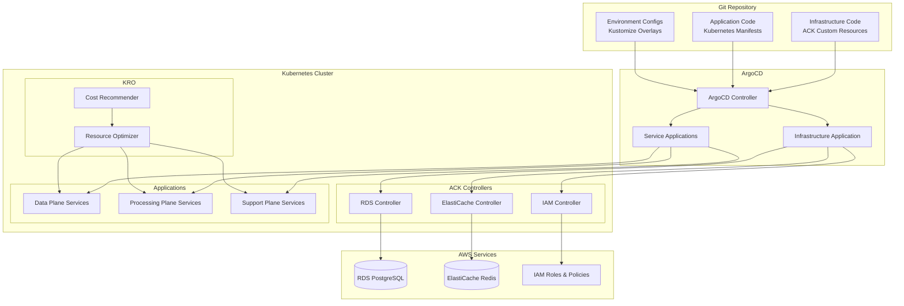

# Cloud-Native Infrastructure Architecture

## Overview

The Cloud Native Encabulator Microservices Demo adopts a fully Kubernetes-native approach to infrastructure management, leveraging AWS Controllers for Kubernetes (ACK), Kube Resource Orchestrator (KRO), and ArgoCD for a complete GitOps-driven infrastructure solution.

## Architecture Principles

### 1. Kubernetes-Native Everything
- All infrastructure defined as Kubernetes Custom Resources
- No external infrastructure tools (Terraform, CloudFormation)
- Consistent RBAC and security model across all resources
- Native Kubernetes lifecycle management

### 2. GitOps-First Approach
- Git as the single source of truth
- Declarative infrastructure definitions
- Automated synchronization and drift detection
- Audit trail for all changes

### 3. Intelligent Resource Management
- Automated resource optimization
- Cost-aware scaling decisions
- Performance-based right-sizing
- Proactive resource recommendations

## Technology Stack

### AWS Controllers for Kubernetes (ACK)
**Purpose**: Manage AWS resources directly from Kubernetes

**Components**:
- **RDS Controller**: Manages PostgreSQL instances for data persistence
- **ElastiCache Controller**: Manages Redis clusters for caching
- **IAM Controller**: Manages roles, policies, and service accounts
- **VPC Controller**: Manages networking resources

**Benefits**:
- Infrastructure as Code through Kubernetes manifests
- GitOps-compatible resource management
- Consistent security and access control
- Native Kubernetes resource lifecycle

```yaml
# Example: RDS PostgreSQL instance
apiVersion: rds.services.k8s.aws/v1alpha1
kind: DBInstance
metadata:
  name: encabulator-postgres
  namespace: encabulator-data
spec:
  dbInstanceIdentifier: encabulator-postgres
  dbInstanceClass: db.t3.micro
  engine: postgres
  engineVersion: "14.9"
  masterUsername: encabulator_user
  masterUserPassword:
    name: postgres-credentials
    key: password
  allocatedStorage: 20
  storageType: gp2
  storageEncrypted: true
  backupRetentionPeriod: 7
  multiAZ: false
  publiclyAccessible: false
  vpcSecurityGroupIds:
    - sg-xxxxxxxxx
  dbSubnetGroupName: encabulator-db-subnet-group
```

### Resource Composition and Orchestration Stack
**Purpose**: Create custom APIs for complex infrastructure deployments using KRO and manage scaling with proven tools

**Components**:
- **Kube Resource Orchestrator (KRO)**: Create custom Kubernetes APIs that orchestrate multiple ACK resources as single units
- **EKS Auto Mode**: Zero-touch node management with automatic provisioning and cost optimization
- **Vertical Pod Autoscaler (VPA)**: Automatically right-sizes CPU and memory requests/limits
- **Horizontal Pod Autoscaler (HPA)**: Scales pods based on CPU, memory, or custom metrics
- **KEDA**: Event-driven autoscaling based on external metrics (queues, databases, etc.)

**Benefits**:
- Simplified infrastructure composition through high-level abstractions
- Automatic dependency management between AWS resources
- Zero-touch node management with EKS Auto Mode
- Reduced operational complexity through resource composition
- Consistent resource lifecycle management

```yaml
# Example: KRO Composite Resource for Database Infrastructure
apiVersion: kro.run/v1alpha1
kind: ResourceGroup
metadata:
  name: encabulator-database
  namespace: kro-system
spec:
  schema:
    apiVersion: apiextensions.k8s.io/v1
    kind: CustomResourceDefinition
    spec:
      group: cloud-native-encabulator.io
      names:
        kind: EncabulatorDatabase
        plural: encabulatordatabases
      versions:
      - name: v1alpha1
        schema:
          openAPIV3Schema:
            type: object
            properties:
              spec:
                type: object
                properties:
                  instanceClass:
                    type: string
                    default: "db.t3.micro"
                  storageSize:
                    type: integer
                    default: 20
                  environment:
                    type: string
                    enum: ["dev", "staging", "prod"]
  resources:
  - id: db-subnet-group
    template:
      apiVersion: rds.services.k8s.aws/v1alpha1
      kind: DBSubnetGroup
      metadata:
        name: "{{ .metadata.name }}-subnet-group"
      spec:
        dbSubnetGroupName: "{{ .metadata.name }}-subnet-group"
        dbSubnetGroupDescription: "Subnet group for {{ .metadata.name }}"
        subnetIds:
        - subnet-12345
        - subnet-67890
  - id: security-group
    template:
      apiVersion: ec2.services.k8s.aws/v1alpha1
      kind: SecurityGroup
      metadata:
        name: "{{ .metadata.name }}-sg"
      spec:
        groupName: "{{ .metadata.name }}-sg"
        description: "Security group for {{ .metadata.name }}"
        vpcId: vpc-12345
  - id: db-instance
    template:
      apiVersion: rds.services.k8s.aws/v1alpha1
      kind: DBInstance
      metadata:
        name: "{{ .metadata.name }}"
      spec:
        dbInstanceIdentifier: "{{ .metadata.name }}"
        dbInstanceClass: "{{ .spec.instanceClass }}"
        engine: postgres
        masterUsername: encabulator_user
        allocatedStorage: "{{ .spec.storageSize }}"
        dbSubnetGroupName: "{{ .metadata.name }}-subnet-group"
        vpcSecurityGroupIds:
        - "{{ .resources.security-group.status.groupId }}"
    dependsOn:
    - db-subnet-group
    - security-group

---
# Example: VPA for automatic right-sizing (works with KRO)
apiVersion: autoscaling.k8s.io/v1
kind: VerticalPodAutoscaler
metadata:
  name: encabulator-postgres-vpa
  namespace: encabulator-data
spec:
  targetRef:
    apiVersion: apps/v1
    kind: StatefulSet
    name: postgres
  updatePolicy:
    updateMode: "Auto"
  resourcePolicy:
    containerPolicies:
    - containerName: postgres
      maxAllowed:
        cpu: 2
        memory: 4Gi
      minAllowed:
        cpu: 100m
        memory: 128Mi

---
# Example: HPA for horizontal scaling (coordinated by KRO)
apiVersion: autoscaling/v2
kind: HorizontalPodAutoscaler
metadata:
  name: encabulator-processor-hpa
  namespace: encabulator-system
spec:
  scaleTargetRef:
    apiVersion: apps/v1
    kind: Deployment
    name: panametric-fam-processor
  minReplicas: 1
  maxReplicas: 10
  metrics:
  - type: Resource
    resource:
      name: cpu
      target:
        type: Utilization
        averageUtilization: 70

---
# Note: EKS Auto Mode handles all node management automatically
# - Automatic node provisioning and scaling
# - Optimal instance type selection based on workload requirements
# - Spot instance integration for cost optimization
# - Zero-touch node lifecycle management
# - Automatic security patching and updates
```

### ArgoCD GitOps Platform
**Purpose**: Continuous delivery and infrastructure synchronization

**Features**:
- **Application Management**: Manages both infrastructure and application deployments
- **Multi-Environment**: Supports dev, staging, and production environments
- **Rollback Capabilities**: Easy rollback to previous configurations
- **Drift Detection**: Automatically detects and can remediate configuration drift

**Benefits**:
- Declarative infrastructure management
- Automated deployment pipelines
- Environment consistency
- Complete audit trail

```yaml
# Example: ArgoCD Application for infrastructure
apiVersion: argoproj.io/v1alpha1
kind: Application
metadata:
  name: encabulator-infrastructure
  namespace: argocd
spec:
  project: cloud-native-encabulator
  source:
    repoURL: https://github.com/your-org/cloud-native-encabulator-microservices
    targetRevision: main
    path: infrastructure/kubernetes/overlays/eks
  destination:
    server: https://kubernetes.default.svc
  syncPolicy:
    automated:
      prune: true
      selfHeal: true
    syncOptions:
      - CreateNamespace=true
```

## Architecture Diagram



## Implementation Benefits

### 1. Simplified Operations
- Single tool chain (kubectl) for all operations
- Consistent security model across infrastructure and applications
- Unified monitoring and observability
- Reduced operational complexity

### 2. Enhanced GitOps
- True Infrastructure as Code with Kubernetes manifests
- Automated drift detection and remediation
- Complete audit trail for compliance
- Environment promotion through Git workflows

### 3. Cost Optimization
- Intelligent resource right-sizing
- Automated cost recommendations
- Performance-aware optimization
- Proactive capacity planning

### 4. Developer Experience
- Familiar Kubernetes tooling and concepts
- Self-service infrastructure through Custom Resources
- Integrated development workflow
- Consistent deployment patterns

## Migration Path

For organizations currently using Terraform or Helm:

1. **Phase 1**: Install ACK controllers alongside existing infrastructure
2. **Phase 2**: Migrate critical resources to ACK Custom Resources
3. **Phase 3**: Implement KRO for resource optimization
4. **Phase 4**: Set up ArgoCD for GitOps workflows
5. **Phase 5**: Decommission legacy infrastructure tools

## Best Practices

### Security
- Use IAM roles for service accounts (IRSA)
- Implement least-privilege access policies
- Enable encryption at rest and in transit
- Regular security scanning and updates

### Monitoring
- Monitor ACK controller health and performance
- Track KRO optimization metrics and savings
- Monitor ArgoCD sync status and drift detection
- Implement comprehensive logging and alerting

### Disaster Recovery
- Regular backup of Kubernetes cluster state
- Cross-region replication for critical data
- Automated disaster recovery procedures
- Regular disaster recovery testing

### EKS Auto Mode Integration

**Purpose**: Zero-touch node management and automatic optimization

**Features**:
- **Automatic Node Provisioning**: Nodes are provisioned automatically based on workload requirements
- **Optimal Instance Selection**: EKS selects the best instance types for your workloads
- **Spot Instance Integration**: Automatic use of spot instances for cost optimization
- **Security Management**: Automatic security patching and updates
- **Cost Optimization**: Intelligent cost management without manual intervention

**Benefits with KRO**:
- KRO handles workload orchestration and placement
- EKS Auto Mode handles node lifecycle and optimization
- Perfect separation of concerns between workload and infrastructure management
- Maximum cost efficiency with minimal operational overhead

This cloud-native infrastructure approach provides a modern, scalable, and cost-effective foundation for the Cloud Native Encabulator Microservices Demo while serving as a reference architecture for production Kubernetes deployments with zero-touch node management.